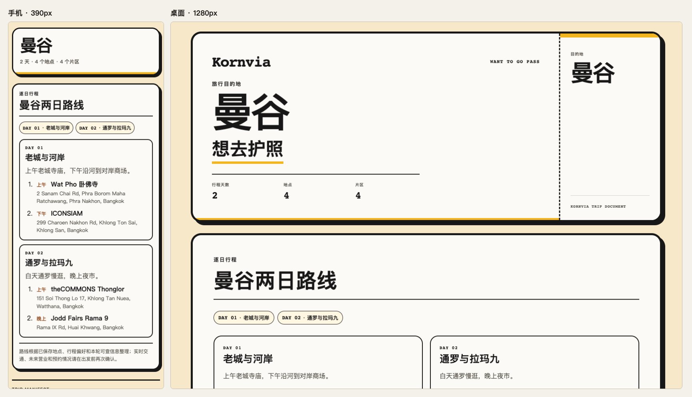

# Want to Go · 想去就出发

Turn saved travel screenshots, links and videos into a workable day-by-day trip and a place passport.



[中文](README.md) · [Download the skill](https://github.com/isook527/want-to-go-trip-planner/releases/latest) · [View the Bangkok example](examples/bangkok/passport.html)

## From saved finds to departure

| Step | What you get |
| --- | --- |
| Save | Keep screenshots, links, videos and notes in a local library by destination. |
| Verify places and branches | Match the address and sources. Keep unresolved finds as leads. |
| Plan the route | Set must-go stops, breaks and backups by day. Use `lint-route` to resolve blockers, explain suggestions and review reminders. |
| Take it with you | Open an illustrated passport, print a PDF, or export an ICS calendar and XLSX workbook. |
| Recheck before leaving | Run agreed T-7, T-3 and T-1 checks for opening hours, reservations, weather and transport. Review changes and a departure checklist. |

## What it won't do

It does not book tickets, monitor in the background or bypass sign-in, CAPTCHA or access restrictions. Opening hours and transfer times are marked for confirmation when evidence is missing. The library, original material and outputs stay on your computer.

## Install

Unzip a [Release](https://github.com/isook527/want-to-go-trip-planner/releases/latest) or copy the whole [`want-to-go-trip-planner/`](want-to-go-trip-planner/) directory from this repository.

| Host | Copy the skill directory to |
| --- | --- |
| Claude Code | `~/.claude/skills/` for all projects, or `.claude/skills/` in the project |
| Codex | `.agents/skills/` in the project |

Install Python 3.9+, Pillow and Node.js 18+. Tesseract, FFmpeg and `opencli` are optional. Run doctor from the directory containing the skill before your first use.

```bash
python3 want-to-go-trip-planner/scripts/extract_evidence.py doctor --locale en-US
```

```powershell
.\want-to-go-trip-planner\scripts\doctor_windows.ps1 -Locale en-US
```

## Quick start

1. “Save these travel finds for me.”
2. “Make a Bangkok Want to Go passport.”
3. “Recheck this trip before I leave.”

## Platform support

**Automatic reading is off by default** for Xiaohongshu, Ctrip and WeChat Official Accounts. Without the optional, integrity-checked `opencli` adapter, the skill keeps the links and asks for screenshots or text. These imports become available after a trusted adapter passes doctor. [Provider details and limitations](want-to-go-trip-planner/references/provider-support.md)

| Platform | What can be read automatically | If reading fails |
| --- | --- | --- |
| Xiaohongshu | The adapter can read accessible full note text and images. | Keep the link and provide screenshots or text. |
| Ctrip | The adapter checks place candidates using the name and link. | Provide a name, screenshots or text. Confirm ambiguous branches. |
| WeChat Official Accounts | The adapter can read accessible public article titles, bodies and image links. | Keep the link and provide screenshots, a saved page or text. |
| Douyin | Titles, descriptions and other metadata returned by the public post. | Provide the original video, key screenshots or text. |
| TikTok, Instagram, YouTube | Titles, thumbnails or embed information returned by public oEmbed. | Provide screenshots, text or the original video. |
| Mafengwo, Dianping | Submitted links and local material are retained. | Provide screenshots, a saved page or text. |

## Privacy and terms

Automatic reading is for personal organization of content you have saved. You are responsible for following each platform's terms of service. This project does not sign in, export cookies or bypass CAPTCHA or access restrictions. Platform names indicate compatibility only. The project is not affiliated with those platforms.

## Tests and contributions

Replay the [Bangkok example](examples/bangkok/README.md) with Python `unittest`. Checks cover customer scanning, areas, routes, lightweight passports, exports and packaging. [Validation record](docs/validation.md) · [Contributing](CONTRIBUTING.md) · [Security reporting](SECURITY.md)

## License

The code is released under [MIT](LICENSE). The Kornvia name and marks are excluded from that license.
