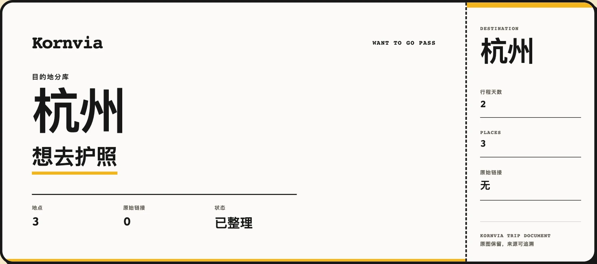
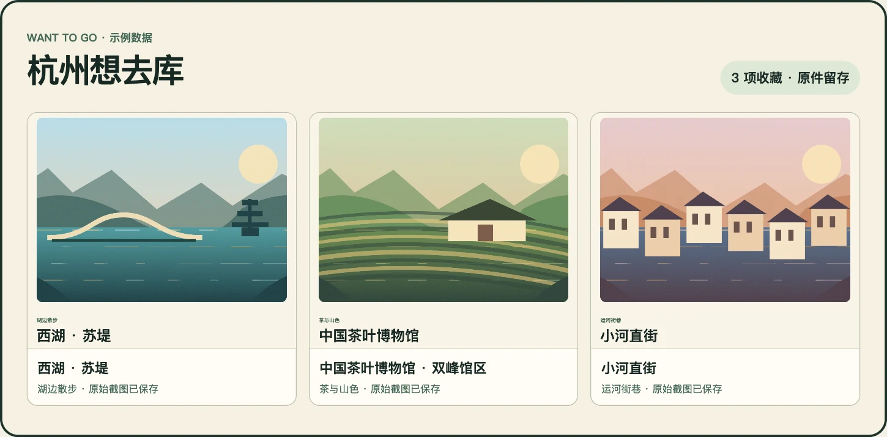
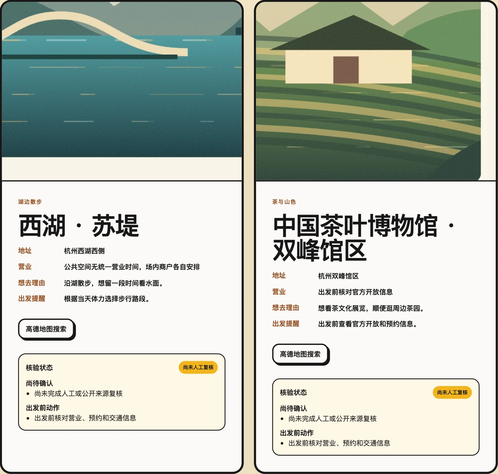
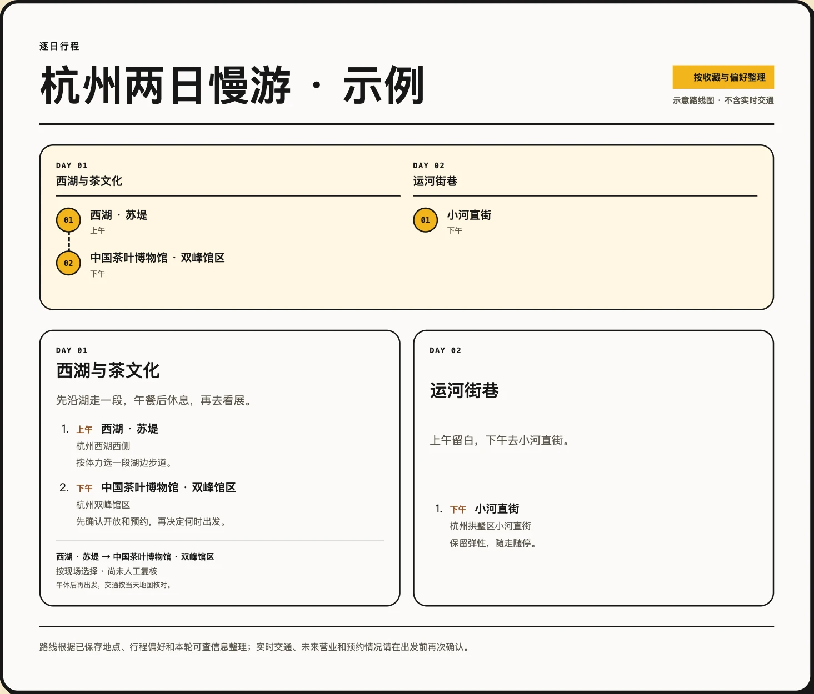

# 想去就出发 · Want to Go

**把刷到的旅行灵感存起来，出发前整理成一份带图、带地图入口的地点护照。**

想去就出发是一个免费的中英双语 Skill。把旅行截图、链接、视频或笔记交给 Agent，它会按目的地建立本地收藏。准备出发时，可以从已存地点生成逐日路线、保留备选，并在出发前按需复核开放、预约和交通信息。

[下载最新版](https://github.com/isook527/want-to-go-trip-planner/releases/latest) · [安装](#安装) · [用法示例](#可以这样说) · [English](#english) · [MIT License](LICENSE)



*以下用杭州两日游演示。收藏素材采用自制插画，图文护照和逐日行程由仓库内的 Skill 生成。*

## 从收藏到出发

### 1. 把原件收进想去库

可以先存下一张截图或一条链接，等行程确定再整理。收藏按城市归档，保留原始截图和来源。支持识别截图里的文字和从本地视频提取画面。暂时打不开的链接可以留待补充。



*这是根据本次入库结果制作的收藏示意。日常通过 Agent 查询收藏。*

### 2. 打开带图的地点护照

地点卡可显示配图、地址、收藏理由、出发提醒和地图入口。适合展示的截图会另存裁切图，纯文字截图可留作证据。HTML 护照可离线打开，点击地图搜索时需要联网。中国大陆地点使用高德地图，其他地区使用 Google Maps。



### 3. 把地点排进每天的行程

告诉 Agent 哪些地方必去、想走多远、什么时候需要休息。路线按天编排，可以留出午休、自由活动和备选地点。证据流程支持保存路线版本、修改和撤销，也能按需做行前复核。HTML 可用浏览器另存为 PDF，还可导出 XLSX 和 ICS。



## 可以这样说

| 你想做什么 | 发给 Agent 的一句话 |
| --- | --- |
| 先收藏 | 用想去就出发收藏这三张截图，放进杭州想去库。 |
| 看带图护照 | 用证据流程整理我的杭州收藏，生成带截图配图和地图入口的护照。 |
| 排一个周末 | 从杭州想去库排两天，苏堤必去，午饭后留休息时间。 |
| 改路线或复核 | 把小河直街改到第二天下午，保留原方案。出发前帮我核对开放和预约信息。 |

## 安装

1. 下载并解压 [Skill ZIP](dist/want-to-go-trip-planner-skill-3.2.0.zip)，也可以复制整个 [Skill 文件夹](skills/want-to-go-trip-planner)。
2. 将 `want-to-go-trip-planner` 文件夹放进 Agent 的本地 Skills 目录。Codex 可放在 `~/.codex/skills/`，Claude Code 可放在 `~/.claude/skills/`。重新打开 Agent 后即可调用。
3. 发一张旅行截图，从上面的收藏示例开始。已有收藏时，可以让 Agent 继续使用原来的库。

| 流程 | 用途 | 环境 |
| --- | --- | --- |
| 本地库 | 快速收藏、查询已有 SQLite 库、地图链接和轻量行程 | Python 3.9+。生成 HTML 另需 Node.js 18+。 |
| 证据流程 | 带截图配图的护照、版本化 JSON 库、路线历史和行前复核 | Python 3.9+、Node.js 18+。图片处理用 Pillow，本地 OCR 和视频拆帧用可用的 Vision/Tesseract 与 FFmpeg。 |

Skill 免费，采用 MIT 许可证。运行时使用本地文件和 Agent 已有能力。地图搜索链接不需要配置地图 API Key。迁移旧库前先复制库文件和资产目录。旧 SQLite 库和 JSON 库各自沿用原来的流程。

[中文工作流](skills/want-to-go-trip-planner/references/workflow.zh-CN.md) · [证据流程](skills/want-to-go-trip-planner/references/evidence-workflow.md) · [规划和导出](skills/want-to-go-trip-planner/references/planning-and-exports.md) · [中文样例](examples/itinerary.zh-CN.json)

## 从一张截图生成护照和日历

在仓库根目录运行下面的 Bash 命令。先准备 Python 3.9+、Node.js 18+，并在当前 Python 环境安装 Pillow（`python3 -m pip install Pillow`）。示例截图、地点和路线都在 [杭州示例文件夹](examples/hangzhou)。示例日期用于演示 ICS，实际行程请填自己的日期。

```bash
skill="skills/want-to-go-trip-planner"
demo="examples/hangzhou"
out=$(mktemp -d)

# 采集截图并保存原件，再将证据导入想去库。
python3 "$skill/scripts/extract_evidence.py" batch --manifest "$demo/manifest.json" --output "$out/evidence.json"
python3 "$skill/scripts/want_to_go.py" ingest --library "$out/library.json" --evidence "$out/evidence.json"

# 建立地点卡，并补齐想去理由、出发提醒和开放信息。
python3 "$skill/scripts/want_to_go.py" promote --library "$out/library.json" --bundle-id demo-hangzhou --selections "$demo/selections.json"
python3 "$skill/scripts/want_to_go.py" edit --library "$out/library.json" --place-id tea-museum --patch "$demo/place-patch.json"

# 先检查路线，再保存并生成图文护照、表格和日历。
python3 "$skill/scripts/want_to_go.py" lint-route --library "$out/library.json" --destination 杭州 --plan "$demo/route.json"
python3 "$skill/scripts/want_to_go.py" route-plan --library "$out/library.json" --destination 杭州 --plan "$demo/route.json"
python3 "$skill/scripts/want_to_go.py" passport --library "$out/library.json" --destination 杭州 --map-region mainland --output "$out/passport.json"
node "$skill/renderer/render_report.mjs" "$out/passport.json" "$out/passport.html"
python3 "$skill/scripts/export_itinerary.py" "$out/passport.json" --xlsx "$out/itinerary.xlsx" --ics "$out/itinerary.ics"
printf '输出目录：%s\n' "$out"
```

例子里的场馆地点需要 `signature`（想去理由）、`visitTip`（出发提醒）和 `openingHoursText`（营业或开放时间），以及名称和地址。真实素材若仍有地点身份疑问，先用 `confirm` 确认。只想做地点护照时，可跳过 `route-plan`，并在 `passport` 命令加 `--places-only`。

要从证据流程导出 ICS，在路线 JSON 的 `tripProfile.startDate` 填写 `YYYY-MM-DD`，保存路线并重新生成护照。系统从起始日期按天推算。日期未定时可先导出 HTML 或 XLSX。[完整导出说明](skills/want-to-go-trip-planner/references/planning-and-exports.md)

## English

Want to Go is a free, MIT-licensed skill that turns travel screenshots, links, videos and notes into a local destination library, a photo-rich place passport and a day-by-day itinerary. The Hangzhou screenshots above show an example of the library data and actual passport output.

Unzip the [Skill download](dist/want-to-go-trip-planner-skill-3.2.0.zip) and put the `want-to-go-trip-planner` folder in your agent’s skills directory. Try “Save these travel screenshots to my Hangzhou library,” then “Use the evidence workflow to make a photo-rich two-day passport from my saved places.”

Library commands run on Python 3.9+. Both workflows use Node.js 18+ to render the same passport layout. The evidence workflow uses Pillow for image processing. You can view the passport offline, print it to PDF, and export an XLSX or ICS file.

[English workflow](skills/want-to-go-trip-planner/references/workflow.en-US.md) · [Evidence workflow](skills/want-to-go-trip-planner/references/evidence-workflow.md) · [English example](examples/itinerary.en-US.json)

## Development

```bash
python3 -m pip install Pillow
python3 -m unittest discover -s tests
python3 skills/want-to-go-trip-planner/scripts/build_release.py --zip dist/want-to-go-trip-planner-skill-3.2.0.zip
```
